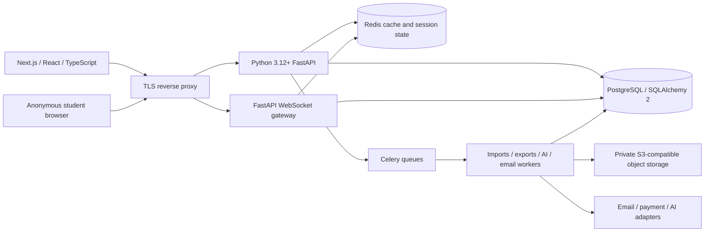
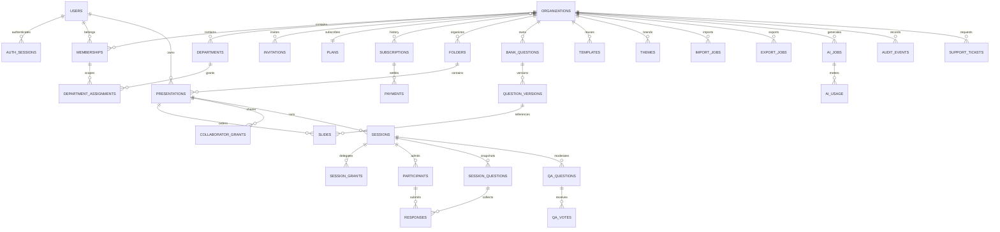

# Quizeee — system blueprint

Status: design baseline, 22 September 2026. Original product identity: Quizeee; deep navy, electric blue and mint, editorial typography, a focused teaching workspace. This is a local source project, not a deployed or production-certified service.

## 1. Architecture

One modular backend initially; deploy API, WebSocket processes and workers independently later. PostgreSQL owns durable records. Redis owns expiring presence, rate counters, disposable cache and live snapshots; it is never the only store of accepted responses. Alembic controls schema upgrades. Celery jobs use stable idempotency keys and bounded retry policies. Separate queues isolate expensive exports and AI from session traffic.

All tenant-owned objects carry organization_id. Every request resolves active membership from the database, applies a permission, then resource scope. Department admins require explicit department assignments. Co-presenter grants belong to a presentation or session and expire/revoke independently of organization roles. Global super-admin status is a separate user attribute; no public request may set it. Support access must be explicitly audited. Faculty Lite grants are configurable subsets of faculty permissions, intersected with plan entitlements.

Use short-lived JWT access credentials in secure HttpOnly same-site cookies; verify Origin on cookie-authenticated mutations. Access credentials carry identity and session ID, not authoritative tenant roles. Persist revocable auth sessions; rotate refresh credentials with reuse detection before release. Passwords use Argon2id. Registration creates one organization and its owner atomically. No shared default admin password. Production secrets come from a secret manager.

## 2. PostgreSQL ERD

### Keys and integrity

UUID primary keys; timestamptz timestamps in UTC. Unique normalized user email, organization slug, (organization_id,user_id) membership, (organization_id,department name), (session_id,participant_id,session_question_id) response, and (qa_question_id,participant_id) vote. Partial unique index on active join codes; random six-digit allocation retries on conflict and expires after session end. Tenant-scoped composite foreign keys prevent cross-organization relationships. Join codes are discovery identifiers, never presenter credentials.

Presentation: owner_id, organization_id, optional department_id/folder_id, title, revision, state, theme_id, timestamps. Slide: presentation_id, ordinal, question_version_id, type, public_config JSONB, private_answer JSONB, notes, hidden. Question bank: subject/chapter/topic/difficulty/marks/explanation/tags, immutable versions; correct answers remain server-side. Live session snapshots freeze question/scoring rules so editor changes cannot alter a running quiz. Monetary values use integer minor units and ISO currency; marks use decimal, never binary float. Audits exclude passwords, tokens and full answer payloads.

## 3. Role and permission matrix

Legend: G global; O organization; D assigned departments; P own presentations; C explicit resource grant; — denied. Student credentials are scoped to one session.

| Capability | Super admin | Owner | Admin | Dept admin | Faculty | Faculty Lite | Co-presenter | Student |
|---|---|---|---|---|---|---|---|---|
| Organizations, plans, platform reports/support | G | — | — | — | — | — | — | — |
| Billing, subscriptions, licenses | G | O | — | — | — | — | — | — |
| Org settings, branding | G | O | O* | — | — | — | — | — |
| Assign org admins / transfer ownership | G | O | — | — | — | — | — | — |
| Users, invitations, departments | G | O | O | D | — | — | — | — |
| Department faculty management | G | O | O | D | — | — | — | — |
| Create/edit presentations | G | O | O | D | P | P* | C* | — |
| Question bank/import/AI | G | O | O | D | P | P* | — | — |
| Templates/themes | G | O | O | D* | P | P* | — | — |
| Start/control live session | G | O | O | D | P | P* | C | — |
| Moderate responses/Q&A | G | O | O | D | P | P* | C | — |
| Analytics/exports | G | O | O | D | P | P* | C* | own result* |
| Submit answers / Q&A / vote | — | — | — | — | — | — | — | session |
| Audit access | G | O | O* | — | — | — | — | — |

* Configurable restrictions apply; no grant can exceed the grantor's scope or plan. Organization owner transfer is atomic and keeps exactly one accountable owner. Department admins cannot promote faculty to an organization-wide role. Co-presenter is deliberately absent from membership role enum. Student results depend on session visibility settings. Billing changes and user impersonation require reauthentication before release.

## 4. Page inventory

| Area | Pages / principal actions |
|---|---|
| Identity | Register organization, sign in/out, verify email, reset password, account/security |
| Workspace | Organization switcher, overview, presentation library, folders, favorites |
| Organization | Members, invitations, licenses, departments, department faculty, settings, branding |
| Faculty | Create chooser: Blank / Template / Import / Question Bank / AI |
| Editor | Three-panel slide editor, notes, question settings, scoring, theme, preview, publish |
| Bank | Search/filter, question detail/version, bulk import upload/validation/preview/commit |
| Reuse | Template gallery/detail, theme editor, shared resources, collaborators |
| Present | Lobby, QR/share link, question/timer controls, results, moderation, leaderboard, winners |
| Student | Join, nickname/consent, waiting room, answer, reconnect, own score, session ended |
| Analytics | Session history, summary, question accuracy, hardest/easiest, individual performance, export jobs |
| Billing | Plans, subscription, seats, invoices, payments, cancellation |
| AI | Prompt/source, generation status, draft review/edit, faculty approval |
| Super admin | Organizations, users, plans, subscriptions/payments, templates, AI usage, reports, support, audit |

## 5. API contract inventory

Base /api/v1. JSON errors use detail initially; expand to a stable {code,message,request_id,fields} envelope before public API release. UUID resource IDs. List pagination with bounded limits. Mutations use revision checks or idempotency keys where retrying could duplicate work. OpenAPI is generated from the implemented routes; this inventory also includes planned routes.

| Module | Endpoints | Authorization |
|---|---|---|
| Auth | POST /auth/register, /auth/login, /auth/logout; GET /auth/me | public rate-limited / authenticated |
| Auth lifecycle | POST /auth/refresh, /auth/verify, /auth/forgot-password, /auth/reset-password | single-use credentials |
| Organizations | GET /organizations; GET/PATCH /organizations/{org}; POST ownership-transfer | membership / owner |
| Membership | GET /organizations/{org}/members; POST invitations; PATCH/DELETE members/{id} | scoped management |
| Departments | GET/POST /organizations/{org}/departments; PATCH/DELETE departments/{id}; PUT assignments | org / assigned scope |
| Presentations | GET/POST /organizations/{org}/presentations; GET/PATCH/DELETE presentations/{id}; POST duplicate/publish | resource scope |
| Slides | POST presentations/{id}/slides; PATCH/DELETE slides/{id}; PUT presentations/{id}/order | edit + revision |
| Bank | GET/POST bank/questions; GET/PATCH questions/{id}; GET versions | scoped bank |
| Imports | POST imports/preview; GET imports/{id}; POST imports/{id}/commit | import entitlement |
| Sessions | POST presentations/{id}/sessions; GET sessions/{id}; POST start/advance/close/end/restart | owner or session grant |
| Participants | POST sessions/join; POST sessions/{id}/responses; GET snapshot | participant session credential |
| Q&A | POST sessions/{id}/questions; PUT questions/{id}/vote; PATCH moderation | participant / moderator |
| Collaboration | GET/POST/DELETE presentation/session grants | resource owner |
| Assets | POST uploads/presign; POST uploads/{id}/complete | type/size/quota validation |
| Analytics | GET sessions/{id}/analytics; GET participants/{id}/performance; POST exports | scoped analytics |
| Billing | GET plans; POST checkout/change/cancel; GET invoices; POST webhooks/{provider} | owner / verified signature |
| AI | POST ai/jobs; GET ai/jobs/{id}; POST ai/jobs/{id}/approve | quota + faculty review |
| Admin | organization/user/plan CRUD; GET usage/reports/audit/support; PATCH support/{id} | explicit global permissions |

## 6. WebSocket protocol

Endpoint /api/v1/sessions/{session_id}/ws. Obtain a single-use, 30-second ticket over authenticated HTTPS; redeem atomically from Redis. Verify Origin; no JWT in query logs. Participant and presenter topics are separate. Never broadcast answer keys or identifiable analytics to participants.

Envelope: {v:1,event_id,sequence,type,session_id,occurred_at,payload}. Commands carry command_id and expected_revision. Acknowledge after durable commit. Reject stale revisions, unknown types, oversize frames and unauthorized commands. Redis Lua/locks serialize transient control state; PostgreSQL constraints protect accepted responses. Durable outbox publishes committed events. At-least-once delivery; deduplicate event IDs and command IDs. Reconnect uses last_sequence; send a role-filtered authoritative snapshot if history expired.

| Direction | Events | Rules |
|---|---|---|
| Client → server | heartbeat, snapshot.request | session credential |
| Presenter → server | session.start, question.open, question.close, session.advance, results.visibility, session.end | control grant |
| Student → server | response.submit, qa.submit, qa.vote | active participant; payload validated against frozen question |
| Moderator → server | qa.approve, qa.dismiss, response.moderate | moderation grant |
| Server → client | connected, snapshot, participant.count, question.opened/closed, timer.sync, response.accepted/rejected, results.updated, leaderboard.updated, winners, session.ended, error | audience-specific payload |

Timer deadlines use server UTC; clients display estimated remaining time. Scores are server-calculated: correct marks + bounded speed bonus (correct answers only), wrong answers subtract configured penalty, unanswered is zero. Multi-select defaults to exact-set correctness; partial credit requires explicit policy. Ties: score, correct count, lower aggregate valid response time, stable participant ID. Scales/NPS/forms/surveys are non-scoring unless explicitly configured. Never accept a client-calculated score.

## 7. Import, export, AI and billing boundaries

CSV/XLSX import: authenticated upload → size/magic/type validation → isolated parse with row/cell/ZIP expansion limits → canonical question validation → preview errors by row → explicit commit. No macro execution, formulas, external links or HTML. CSV/Excel exports escape formula prefixes. PDF/PNG generated in workers from controlled templates, never arbitrary URLs. Private export URLs expire and require ownership checks. Retention deletes source files after processing.

AI: reserve organization quota → provider call in worker → validate typed questions → save draft → faculty review/edit → explicit approval → ordinary presentation publish. AI output is untrusted content; it cannot grant roles, run tools or publish itself. Track model, cost, user and organization. Missing provider credentials disable generation with an explicit unavailable state.

Plans Free/Basic/Pro/Enterprise are rows with versioned entitlements. Subscriptions reference a plan version. Signed payment webhooks, unique provider event IDs, currency/amount verification and reconciliation determine entitlements. A checkout redirect never proves payment. No real billing actions occur without configured merchant credentials.

## 8. Development roadmap and release gates

1. **Auth/RBAC:** tenant schema, Argon2/JWT, revocation, fail-closed rate limits, scope tests. Gate: forged/expired/revoked credentials denied; no tenant leakage.
2. **Organization:** ownership, members/invitations, licenses, settings and audited role changes. Gate: escalation and final-owner removal tests.
3. **Departments:** assignments and department-scoped management. Gate: assigned/unassigned access tests.
4. **Presentations:** library, folders, revision-safe CRUD, collaboration, themes. Gate: edit conflict, tenant isolation, accessibility.
5. **Quiz Builder:** all requested types, question bank, validated bulk import, previews and scoring policy. Gate: type-specific validation and round-trip import tests.
6. **Live Sessions:** snapshots, waiting room/code/QR, controls, authenticated sockets, Redis fan-out, scoring, moderation/reconnect. Gate: real multi-client races, duplicate response tests and agreed load target.
7. **Analytics:** histories, response rate, accuracy and individual performance, CSV/XLSX/PDF/PNG. Gate: reconcile aggregates against accepted responses; export isolation/formula safety.
8. **Billing:** versioned plans/entitlements, provider checkout/webhooks, invoices. Gate: sandbox signatures, retries, duplicate/out-of-order events.
9. **AI:** metering, drafts, faculty approval. Gate: quota races, malicious content, approval cannot be bypassed.
10. **Admin:** scoped operations, support, audit/reporting. Gate: reauthentication, audit completeness, tenant boundaries.

Production gate across all modules: dependency/security review, HTTPS/secret rotation, PostgreSQL backup AND restore drill, migration rehearsal and rollback strategy, monitoring/alerts, worker retries/dead letters, accessibility/mobile/browser QA, agreed privacy/retention policy, email delivery, incident runbook and sustained concurrency tests. Infrastructure sizing awaits a measured concurrency target; 1,000 students/session is a design test scenario, not a certified capacity.

## 9. Implementation ledger

The companion README records what is implemented and tested. Everything in this blueprint is planned unless that ledger explicitly marks it delivered. Do not equate an ERD entity, page inventory or API proposal with a running feature.

References checked: [FastAPI JWT/password tutorial](https://fastapi.tiangolo.com/tutorial/security/oauth2-jwt/), [Next.js App Router installation](https://nextjs.org/docs/app/getting-started/installation). These guide framework integration; the authorization model above is specific to Quizeee.
