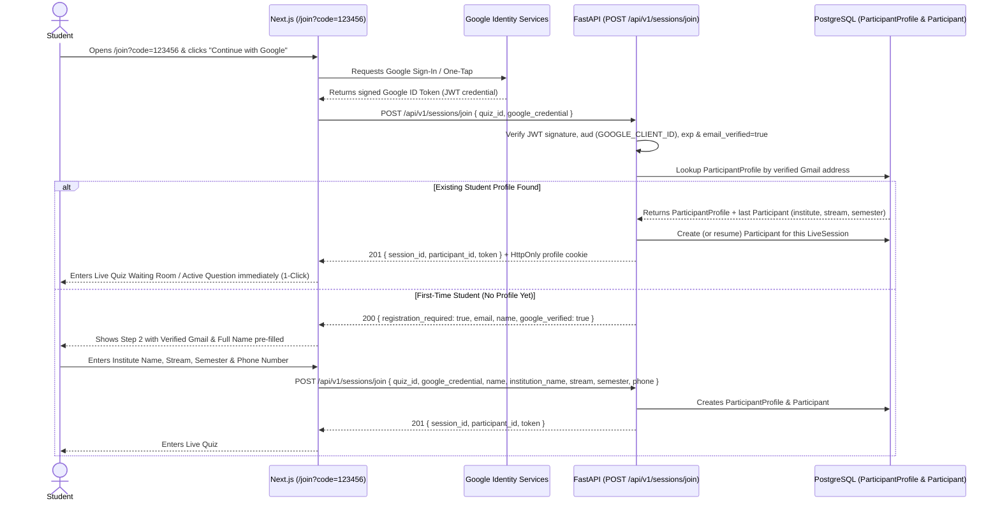

# Implementation Plan: Direct Student Quiz Entry via Google / Gmail Account

## 1. Objective

Enable students joining a live quiz (`/join?code=XXXXXX`) to enter **directly using their Google / Gmail account** (`Continue with Google`), while keeping the existing manual email entry flow as a fallback.

- **Returning students (already in `participant_profiles`):** Enter the quiz **in 1 click** via Google Sign-In—no typing of email, name, institute, stream, semester, or phone required.
- **First-time students (new Gmail address):** Google Sign-In verifies their Gmail address and auto-fills their **Full Name** from their Google profile; they only fill in their **Institute Name, Stream, Semester, and Phone Number** once. On all future quizzes, they enter in 1 click.
- **Cross-tab / Cross-device Rejoin:** Because a Google ID Token cryptographically proves ownership of the student's Gmail address, a student who accidentally closes their browser or switches devices during an active live quiz can sign in with the same Google account to resume their existing attempt instead of being blocked by `409 Already joined`.

---

## 2. End-to-End Flow Diagram



---

## 3. Google Cloud Console Setup

You already have a Google OAuth Client JSON file (`64399029854-vuhjqo6gl2oas3ckj44e0t0blkhotihh.apps.googleusercontent.com`). Before enabling the feature in production:

1. Open **Google Cloud Console → APIs & Services → Credentials**.
2. Select your **OAuth 2.0 Client ID** (`Web application`).
3. Under **Authorized JavaScript origins**, add:
   - `https://bdattest.com`
   - `http://localhost:3000` *(for local testing)*
4. Under **Authorized redirect URIs**, add:
   - `https://bdattest.com`
   - `https://bdattest.com/join`
   - `http://localhost:3000/join`
5. Under **OAuth consent screen**:
   - Set **Publishing status** to **In production** (so any student with a `@gmail.com` or college Google Workspace email can sign in without being added as a test user).
   - Scopes needed: standard non-sensitive `openid`, `email`, `profile`.

> **Security Note:** Never commit the `client_secret_*.json` file to Git. Google Identity Services (Sign In With Google button) uses signed ID tokens (`credential`), which only require the public **Client ID** (`64399029854-vuhjqo6gl2oas3ckj44e0t0blkhotihh.apps.googleusercontent.com`) on both frontend and backend.

---

## 4. Planned Backend Changes (`backend/`)

### 4.1 `backend/app/config.py`
Add the Google OAuth Client ID setting to `Settings`:
```python
google_client_id: str = Field(default="", max_length=250)
```

### 4.2 Google ID Token Verification Helper (`backend/app/google_auth.py` or inside `backend/app/live_routes.py`)
Verify the `google_credential` JWT sent by the browser:
- Verify the JWT signature against Google's public certs (`https://www.googleapis.com/oauth2/v3/certs` using `PyJWT[crypto]` or Google's tokeninfo/JWKS cache).
- Validate claims:
  - `aud == settings().google_client_id`
  - `iss in {"accounts.google.com", "https://accounts.google.com"}`
  - `exp` has not passed
  - `email_verified is True`
- Return `{ "email": claims["email"].casefold(), "name": claims.get("name", "").strip()[:60], "sub": claims["sub"] }`.

### 4.3 `backend/app/live_routes.py` (`Join` Schema & `POST /api/v1/sessions/join`)
1. **Extend `Join` Request Model:**
   ```python
   class Join(BaseModel):
       ...
       google_credential: str | None = Field(default=None, min_length=20, max_length=4096)
   ```
2. **Update `join()` Endpoint Logic:**
   - If `data.google_credential` is present:
     - Call `verify_google_id_token(data.google_credential)`.
     - Override `email = google_claims["email"]` and default `name = data.name or google_claims["name"]`.
     - Mark `google_verified = True`.
   - Look up `profile = db.scalar(select(ParticipantProfile).where(ParticipantProfile.email == email))`.
   - **If `profile` does not exist:**
     - If mandatory academic fields (`name`, `phone`, `institution_name`, `stream`, `semester`) are not yet provided in `data`, return:
       ```json
       {
         "registration_required": true,
         "email": "student@gmail.com",
         "name": "Student Name From Google",
         "google_verified": true
       }
       ```
     - Once submitted with the mandatory fields, create `ParticipantProfile(name=name, email=email, phone=data.phone)` and proceed.
   - **If `profile` already exists:**
     - Look up existing `participant` in the current `LiveSession` (`Participant.session_id == session.id, Participant.profile_id == profile.id`).
     - **Safe Rejoin Enhancement:** If `participant` already exists for this session and `google_verified is True`, issue a fresh `token = secrets.token_urlsafe(32)`, update `participant.token_hash`, and return `{session_id, participant_id, token}` so the student can resume their active quiz even if their browser storage was cleared.
     - Otherwise, create the new `Participant` row copying `stream`, `semester`, and `institution_name` from `data` or from their most recent prior `Participant` record (`prior`), issue the `quizeee_profile` cookie, and return `{session_id, participant_id, token}`.

### 4.4 Database Schema Impact
- **Zero destructive migrations required.**
- Existing `participant_profiles` (`id`, `name`, `email`, `phone`) and `participants` (`institution_name`, `stream`, `semester`) tables already store all needed student fields and index `email` uniquely.

---

## 5. Planned Frontend Changes (`frontend/`)

### 5.1 `frontend/app/join/page.tsx`
1. **New State Variables:**
   - `googleCredential`: stores the verified Google JWT during the session join / registration step.
   - `fullName`: pre-filled from Google (`d.name`) when a first-time student transitions to Step 2.
2. **Google Sign-In Button on Step 1 (`!registration`):**
   - Load `https://accounts.google.com/gsi/client` asynchronously when `process.env.NEXT_PUBLIC_GOOGLE_CLIENT_ID` is set.
   - Render the official **"Continue with Google"** button at the top of the `Enter Quiz` card:
     - When the student selects their Google account, Google invokes the callback with `response.credential`.
     - Frontend immediately calls `POST /api/v1/sessions/join` with `{ quiz_id: code, google_credential: response.credential }`.
   - Below the Google button, keep a clean `"OR"` divider and the existing manual Email input box so students without a Google account on their device can still join normally.
3. **Pre-Filled Step 2 (`registration === true`) for First-Time Google Students:**
   - Display the verified Gmail badge (`Verified with Google: student@gmail.com`).
   - Pre-fill the **Full Name** input with the name returned from Google (`defaultValue={fullName}`), while allowing the student to edit it if needed.
   - Focus directly on **Institute Name**, followed by **Stream**, **Semester**, and **Phone Number**.
   - On submit, include `google_credential` so the backend has cryptographic proof of the email during profile creation.

### 5.2 `frontend/Dockerfile` & `compose.yaml`
Expose the public Client ID to both the Next.js build and the FastAPI backend:
- In `.env` and `.env.example`:
  ```dotenv
  GOOGLE_CLIENT_ID=64399029854-vuhjqo6gl2oas3ckj44e0t0blkhotihh.apps.googleusercontent.com
  NEXT_PUBLIC_GOOGLE_CLIENT_ID=64399029854-vuhjqo6gl2oas3ckj44e0t0blkhotihh.apps.googleusercontent.com
  ```
- In `compose.yaml`:
  - Pass `GOOGLE_CLIENT_ID: ${GOOGLE_CLIENT_ID:-}` under `&backend-env`.
  - Pass `NEXT_PUBLIC_GOOGLE_CLIENT_ID: ${NEXT_PUBLIC_GOOGLE_CLIENT_ID:-}` under `web.build.args`.
- In `frontend/Dockerfile`:
  - Add `ARG NEXT_PUBLIC_GOOGLE_CLIENT_ID` and `ENV NEXT_PUBLIC_GOOGLE_CLIENT_ID=$NEXT_PUBLIC_GOOGLE_CLIENT_ID` alongside `NEXT_PUBLIC_WS_ORIGIN`.

---

## 6. Verification & Testing Plan

1. **Backend Unit Tests (`backend/tests/test_google_join.py`):**
   - Test first-time Google student join returns `registration_required: True` with `email` and `name` extracted from a mocked Google ID token.
   - Test completing registration creates `ParticipantProfile` and `Participant` with `institution_name`, `stream`, `semester`, and `phone`.
   - Test returning Google student joins a new quiz session in **1 step** (no registration prompt) and inherits their saved `institution_name`, `stream`, and `semester`.
   - Test returning Google student who lost browser `sessionStorage` can rejoin the same active session via Google Sign-In without getting a `409` error.
   - Test expired, tampered, or wrong-audience (`aud`) Google tokens are rejected with `401 Unauthorized`.
2. **Production VPS Deployment Steps (When Ready to Implement):**
   - Add `GOOGLE_CLIENT_ID` and `NEXT_PUBLIC_GOOGLE_CLIENT_ID` to `/opt/quizeee/.env` on `31.97.235.2`.
   - Rebuild and recreate `api`, `worker`, and `web`:
     ```bash
     docker compose build api worker web
     docker compose up -d --no-deps --force-recreate api worker web
     ```
